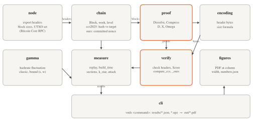
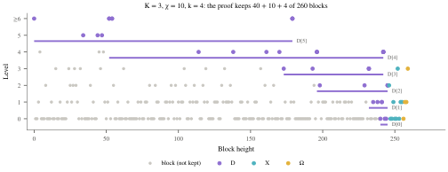
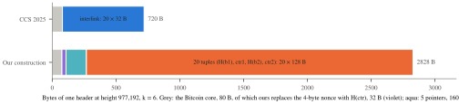
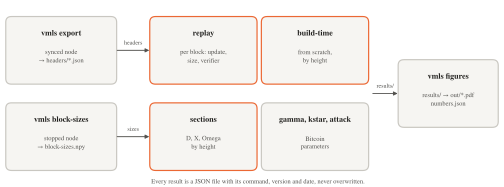

# Mining in Logarithmic Space with Variable Difficulty

NIPoPoWs (Non-Interactive Proofs of Proof-of-Work) for chains whose mining difficulty varies, replayed over the real
Bitcoin header chain.

A NIPoPoW keeps a logarithmic number of blocks of a proof-of-work chain, sampled by level, so that a light client can
compare two chains without downloading them. This repository implements the prover and the verifiers of two
constructions, replays them over the whole history of Bitcoin, and measures what they cost: proof size, prover and
verifier time, and the Bitcoin parameters the security proofs assume.

- **CCS 2025** (`ccs2025`): the construction of the CCS 2025 paper. A block's level compares its hash with its own
  target, and the verifier compares the work of the blocks after the last common block of two proofs.
- **Our construction** (`ours`): the level of a block stays hidden until the block is k blocks deep (blind mining,
  against targeted block suppression), and the verifier caps each block's work at v times the median (Score, against
  difficulty manipulation).

## Papers

**CCS 2025.** Loïc Miller, Dorian Pacaud, Nathanaël Derousseaux-Lebert, Emmanuelle Anceaume and Romaric Ludinard.
*Mining in Logarithmic Space with Variable Difficulty.* ACM CCS 2025, DOI
[10.1145/3719027.3744874](https://doi.org/10.1145/3719027.3744874). The code and data of the paper are tagged
[`ccs-2025`](../../tree/ccs-2025); the published figures are in [`paper-figures/ccs-2025/`](paper-figures/ccs-2025).
The CCS 2025 construction of this version gives the same levels and the same proofs, block for block (see Tests).

## Install

Python 3.12 or later.

```bash
python3 -m venv ~/.venvs/vmls
~/.venvs/vmls/bin/pip install -e '.[dev]'
~/.venvs/vmls/bin/vmls --help
~/.venvs/vmls/bin/python -m pytest        # fast tests, on synthetic chains
```

## How it fits together



- **chain** reads exported headers into blocks, each with its work (Bitcoin's chain work) and its level under a
  construction. Under CCS 2025, the largest μ with hash · 2^μ ≤ target. Under ours, the number of leading zero bits
  of H(ctr, y), y the proof-of-work hash and ctr a nonce committed in the header as H(ctr); a block whose nonce is never
  revealed has level 0. **Bitcoin headers carry no committed nonce: each block gets one derived from its hash**, so
  that levels follow the distribution of a chain mined that way and runs are reproducible. This is the main assumption
  of the measurements.
- **proof** is the prover (Algorithm 1 of the papers), the same for both constructions.
- **encoding** writes each header, and **verify** reads them back to check a proof, then compares two.
- **measure** runs the measurements, **gamma** estimates the hashrate fluctuation, **node** talks to Bitcoin Core,
  **figures** draws the results, **cli** is the command line.

### A proof



A proof keeps three parts of the chain (`vmls.proof.Params`):

- **Ω**, the last k blocks, kept whole (k = 6, Bitcoin's common prefix);
- **X**, the χ = 2m = 4032 headers before them, so that a miner can recompute the next target;
- **D**, sampled from the rest: at the proof level ℓ, every ℓ-block; at each level μ below, the last 2K μ-blocks and
  every μ-block after the K-th last (μ+1)-block. K is K\* in the papers.

A proof is itself a chain: a prover updates it by compressing it with each new block, without ever holding the chain.

### A header



`vmls.encoding` writes the bytes of each header, and `header_size` gives their length by formula (a test checks that
both agree at every height). Under CCS 2025, the 80-byte Bitcoin header and an interlink: one pointer per level μ to
the last μ-block before the block. Under ours, the 4-byte nonce becomes H(ctr); k − 1 pointers to the predecessors
besides the previous hash; and per level a tuple (H(b1), ctr1, H(b2), ctr2) for the last two revealed μ-blocks, whose
H(b2) is the interlink. The exports hold the hash, bits and time of each block but not its version, Merkle root and
nonce: those fields are zero, while every pointer holds the real hash of the block it designates, so that the verifier
can check that each proof is linked.

## Usage



```bash
vmls export --datadir ~/.bitcoin --reference headers/headers.zip       # headers of a synced node -> headers/
vmls block-sizes --datadir ~/.bitcoin --headers H                      # size of every block (stopped node)
vmls replay --construction ours --headers H -K 208                     # proof grown block by block, verifier
vmls build-time --headers H                                            # proof built from scratch, by height
vmls sections --headers H --block-sizes results/block-sizes.npy        # size of D, X and Omega, by height
vmls gamma classic --headers H --since 2020-01-01                      # hashrate fluctuation, recent period
vmls kstar --headers H                                                 # K* the security bound asks for
vmls attack --headers H                                                # zero-difficulty attack over time
vmls figures --results results --out-dir out                           # every figure the results allow
```

`H` is a headers file (`.json`, `.json.xz`, or the `.zip` of this repository). Each result is a JSON file holding the
command, the version and the date, and it is never overwritten; `vmls replay` also writes the per-block series as NPZ.
The constructions default to both, K to {104, 208, 416} and k to 6. Timings run on one thread.

## Comparing with CCS 2025

Every measurement runs both constructions on the same chain, and every figure draws both. To check the CCS 2025
construction against the code of the paper, the slow tests compare the levels of all 865,043 blocks and the proof sizes
and levels of the paper's data (K = 104 and 208, k = 323). To redraw the paper's figures exactly, use the tag
`ccs-2025`.

## Tests

```bash
python -m pytest              # synthetic chains: properties of the prover, every tampering the verifier must catch,
                              # the zero-difficulty attack, header sizes, the command line (about a minute)
python -m pytest --runslow    # also the regressions on Bitcoin (a few minutes)
```

The slow tests need the headers and reference data, kept outside the repository: `VMLS_HEADERS` points to a headers
export and `VMLS_REFERENCE` to the reference directory (see `tests/conftest.py`); they are skipped when missing.

## Bitcoin data

`headers/headers.zip` holds the 865,043 headers used by the CCS 2025 paper (up to October 11, 2024). To extend them,
run a synced Bitcoin Core node and `vmls export`: it checks that the chain is contiguous down to the genesis block and
extends the previous export. `vmls block-sizes` reads the size of every block from a stopped node's block files, in a
few minutes; `vmls utxo` asks a running node for the size of the UTXO set at the tip.

RPC credentials never go in the repository: the client reads the node's cookie, then `~/.config/vmls/rpc.env`
(`VMLS_RPC_USER=…` and `VMLS_RPC_PASSWORD=…`, readable by you only; see `rpc.env.example`), then the environment
variables of the same names.

## History

- **Version 2** (in progress): written anew as the package `vmls` and the command `vmls`. See
  [CHANGELOG.md](CHANGELOG.md).
- **Version 1.0.0** (2025-04-25, tags `v1.0.0` and `ccs-2025`): the code and data of the CCS 2025 paper.

## Citing

The code is by Loïc Miller. The CCS 2025 construction is the work of all the authors of the CCS 2025 paper, and our
construction of the authors of the paper that describes it. Cite the paper, and the version of this code you used;
[CITATION.cff](CITATION.cff) holds both.

## Security

See [SECURITY.md](SECURITY.md); to contribute, [CONTRIBUTING.md](CONTRIBUTING.md).

## License

MIT. See [LICENSE](LICENSE).
